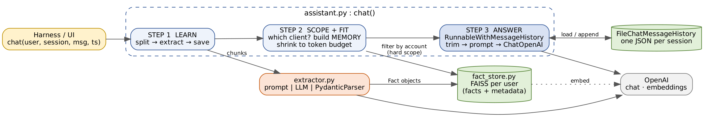

# Pilot - see GUIDE.md for the full walkthrough

**Stack:** `ChatOpenAI` · `OpenAIEmbeddings` · FAISS vector store · `RunnableWithMessageHistory` · `trim_messages`.

---

## The idea in 30 seconds

The original Pilot used the **chat history as its memory**. History is short, per-session and ordered by time, so facts
get evicted and clients get mixed. The fix is to separate two things:

| | What it is | Where it lives | Used for |
|---|---|---|---|
| **Short-term** | the last few turns of *this* session, verbatim | `FileChatMessageHistory` + `trim_messages` | conversational flow |
| **Long-term** | small, dated, per-client **facts** the user stated | **FAISS** vector store, one per user | everything the user said before |

Every message is **learned** (turned into facts) *before* the reply, and every reply gets only the facts of the
**client being discussed**, inside a fixed token budget.



---

## 1. Install (5 minutes)

Requires **Python 3.11+** (tested on 3.12).

```bash
# 1. get the code and enter the folder
cd pilot-lc

# 2. create an isolated environment
python -m venv .venv
source .venv/bin/activate            # Windows PowerShell:  .venv\Scripts\Activate.ps1

# 3. install dependencies
pip install -r requirements.txt

# 4. (only for LIVE runs) set your OpenAI key. Tests and the offline walkthrough do NOT need it.
export OPENAI_API_KEY="sk-..."       # Windows PowerShell:  $env:OPENAI_API_KEY="sk-..."
```

Check the install: `python -m pytest -q tests`  →  `16 passed`.

---

## 2. Repo map (read in this order)

| File | Purpose | Lines to read first |
|---|---|---|
| `pilot_lc/config.py` | every knob + its trade-off | the comments |
| `pilot_lc/prompts.py` | the reply rules and the extraction prompt (each rule is tagged with the problem it fixes) | `REPLY_SYSTEM` |
| `pilot_lc/fact_store.py` | **the memory**: FAISS wrapper, `Fact` schema, scoped search, supersession | `add`, `for_account` |
| `pilot_lc/extractor.py` | message → facts (`prompt \| llm \| PydanticOutputParser`) | `extract` |
| `pilot_lc/retriever.py` | which client? what goes in the MEMORY block? | `build_memory` |
| `pilot_lc/assistant.py` | **the orchestrator**: `chat()` in 3 steps | `chat`, `_learn`, `_fit_memory` |
| `pilot_lc/models.py` | the only file that touches OpenAI constructors | all |
| `pilot_lc/offline.py` | fake LLM / embeddings so everything runs without a key | all |
| `tests/test_p1…p6_*.py` | **one test file per user complaint**, each documents problem → cause → fix | docstrings |
| `scripts/walkthrough.py` | prints what the model *actually received* for each problem | run it |

---

## 3. Quick walkthrough (10 minutes, no API key)

```bash
python scripts/walkthrough.py            # all six problems
python scripts/walkthrough.py --only 5   # just one (1-6)
```

For each problem it shows: what the user said → **the MEMORY block the model received** → input tokens vs the 8,000 limit.
Real output (Problem 5, cross-client leak):

```
(a) client NAMED -> hard scope: Fabrikam's Priya must not appear
USER: Prep me for my Contoso call. What does Priya care about?
  Accounts on file: Contoso, Fabrikam
  == Contoso ==
  - [Contoso] (contact) Priya Nair is the CFO at Contoso and cares most about payback period. (logged 2026-03-02)
  END OF MEMORY. Anything not listed above is NOT on record.
INPUT TOKENS: 340  (limit 8,000)
(b) client NOT named -> both shown, each labelled with its client
  - [Contoso] (contact) Priya Nair ...      - [Fabrikam] (contact) Priya Menon ...
```

**Live mode** (real OpenAI, real embeddings, real replies): `python scripts/walkthrough.py --live`

---

## 4. How `chat()` works (the whole system)

```text
chat(user, session, message, ts)
 │
 ├─ STEP 1  LEARN     _learn():  split message into chunks → LLM extracts Facts → FAISS.add (saved to disk at once)
 │
 ├─ STEP 2  SCOPE+FIT _fit_memory():
 │            client named?  YES → only that client's facts (HARD scope)   NO → labelled search across clients
 │            preferences/contacts/status always included; notes/events by similarity
 │            estimate tokens (×1.3 safety); halve memory until under 7,000
 │
 └─ STEP 3  ANSWER    RunnableWithMessageHistory( trim_messages → prompt → ChatOpenAI )
                      returns Reply(text, input_tokens)   # input_tokens = OpenAI's own usage_metadata
```

**Why learn *first*?** If the reply call fails, the user's facts are already saved (write-ahead). It also means
`end_session()` can be skipped, as the brief says it may be, without losing anything.

---

## 5. Problem → root cause → fix → test

| # | User complaint | Root cause | Fix (where in code) | Run this test |
|---|---|---|---|---|
| 1 | CFO's one-page rule forgotten by Thursday | Per-session history; Monday evicted | Preference saved as FAISS fact; **always** included for that client (`fact_store.for_account`, `retriever.build_memory`); rule 3 makes it binding (`prompts.py`) | `pytest tests/test_p1_preference_forgotten.py -v` |
| 2 | Re-explain who is who each morning | No durable people/roles | Contacts saved as facts with person + client metadata; client roster always shown | `pytest tests/test_p2_who_is_who.py -v` |
| 3 | Pasted chats: slow, costly, confused | History stuffed into every call | Paste split into chunks and **ingested once** (`assistant._learn`); reply sees a clipped excerpt (`_clip_middle`); cost per reply stays flat | `pytest tests/test_p3_pasted_history.py -v` |
| 4 | Ignores the morning after a long day | Verbatim history overflows within one session | `trim_messages` bounds the window; everything also saved as facts, so evicted turns are still retrievable | `pytest tests/test_p4_long_day.py -v` |
| 5 | Contact from another client | All clients in one flat context | FAISS **metadata filter** `{"account": X}` = hard scope; labels when no client named | `pytest tests/test_p5_cross_client_leak.py -v` |
| 6 | Confident invented date | Model not told what it doesn't know | `END OF MEMORY … NOT on record` boundary + rule 4 "never guess"; only **user** statements become facts | `pytest tests/test_p6_hallucinated_fact.py -v` |
| – | Brief's rules: restart, skipped `end_session`, user isolation, `ts` not clock, ≤8,000 tokens, corrections, outages | | per-user FAISS folders; learn-per-message; supersession by `key`; budget guard; graceful fallbacks | `pytest tests/test_contract_and_robustness.py -v` |

Run everything: `python -m pytest -v tests`  →  16 passed.
Each test file's docstring states **problem, cause, fix and what the test proves**; 
---

## 6. Run the modules one by one (guided tour)

Each snippet is copy-paste; use `python` in the repo root. (Offline doubles keep it keyless.)

**a) Settings and trade-offs**
```python
from pilot_lc.config import Settings
print(Settings.from_dict({"model": "gpt-4o", "history_tokens": 1000}))
```

**b) The memory store alone (FAISS)**
```python
import tempfile
from datetime import datetime
from pathlib import Path
from pilot_lc.fact_store import FactStore, Fact
from pilot_lc.offline import HashingEmbeddings
s = FactStore(Path(tempfile.mkdtemp()), HashingEmbeddings())
s.add(Fact(account="Acme", kind="preference", text="Acme's CFO wants one-page summaries."), datetime(2026,3,2))
s.add(Fact(account="Fabrikam", kind="contact", text="Priya Menon leads procurement at Fabrikam."), datetime(2026,3,2))
print(s.for_account("Acme", "outline proposal", n_relevant=3, n_core=5))   # only Acme facts come back
```

**c) Building the MEMORY block**
```python
from pilot_lc.retriever import build_memory
print(build_memory(s, "Prep me for Acme", n_relevant=3, n_core=5, max_accounts=3))
```

**d) The extractor (scripted LLM)**
```python
from pilot_lc.extractor import Extractor
from pilot_lc.offline import scripted_extractor
ex = Extractor(scripted_extractor({"cfo": [{"account": "Acme", "kind": "contact", "text": "Dana is Acme's CFO."}]}))
print(ex.extract("Dana is the CFO", datetime(2026,3,2), ["Acme"]))
```

**e) The full assistant** → `python scripts/walkthrough.py`.

---

## 7. Live run with real OpenAI

```python
from datetime import datetime
from pilot_lc import Assistant

a = Assistant("./data", {"model": "gpt-4o-mini", "api_key_env": "OPENAI_API_KEY"})
a.chat("u1", "mon", "Just off a call with Acme. Their CFO Dana Ruiz wants one-page summaries.", datetime(2026, 3, 2, 9))
# ...restart the process, any time later...
a = Assistant("./data", {"model": "gpt-4o-mini", "api_key_env": "OPENAI_API_KEY"})
r = a.chat("u1", "thu", "Outline the Acme renewal proposal.", datetime(2026, 3, 5, 16))
print(r.text, r.input_tokens)
```
Things to check live: does the reply apply the one-page rule (P1)? For "When did Globex start?" does it say *no record* (P6)?
Does the extractor produce clean facts? (inspect `data/users/u1/facts/`; add `print(store.search_all("", 50))`).

---

## Product update component integration - Skipped as clarified

